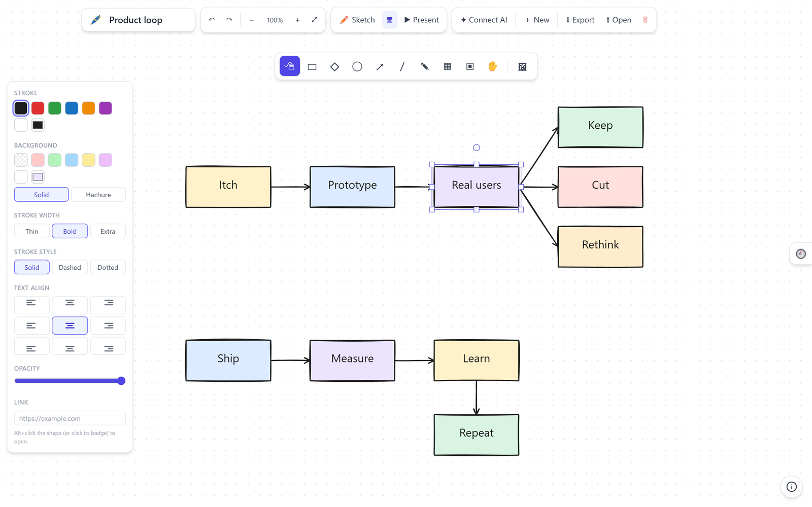
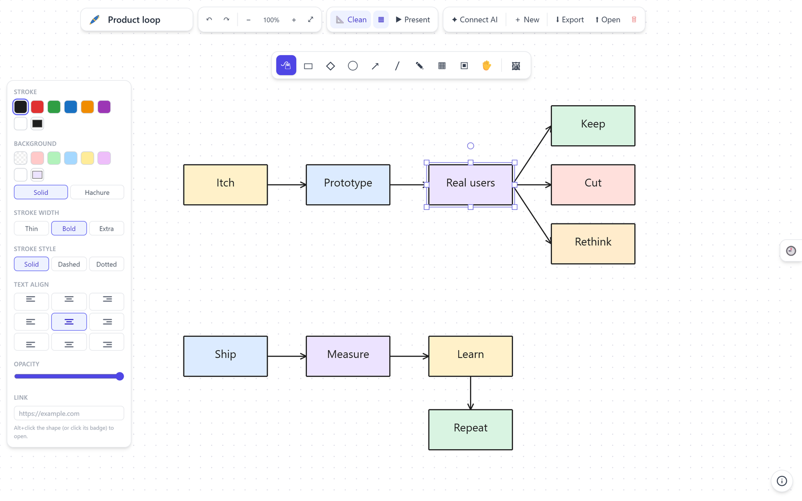

# Drawesome

A fast, browser-based whiteboard for sketching diagrams, flowcharts, and wireframes — with smart connectors, magnetic alignment guides, and text-to-diagram generation. Built with React, TypeScript, and roughjs for that hand-drawn look.

Live app: [anandd512.github.io/drawesome](https://anandd512.github.io/drawesome/) · The story: [ananddeshpande.in/projects/drawesome](https://ananddeshpande.in/projects/drawesome/)



<details>
<summary>Same diagram in the clean theme</summary>



</details>

## Features

- **Shapes & tools** — rectangle, diamond, ellipse, line, arrow, freehand pencil, and tables. Tools stay active so you can draw several in a row.
- **Smart arrows** — arrows suggest connection points near shapes (PowerPoint-style) and stay attached when you move the shape.
- **Magnetic snapping** — dotted alignment guides appear as edges and centers line up with nearby shapes.
- **Auto-fitting labels** — double-click any shape to add a label that wraps across lines; the shape grows to fit. Align text to 9 positions.
- **Quick-node spawning** — `Ctrl/Cmd + Arrow` spawns a connected shape in that direction.
- **Text-to-diagram** — describe a flow (e.g. `Login -> Dashboard -> Logout`) and generate a diagram automatically.
- **Images & hyperlinks** — insert or paste images; attach URLs to shapes.
- **Sketch / clean themes** — toggle between a hand-drawn look and crisp lines.
- **Presentation mode**, export/import scenes as JSON, undo/redo, zoom, and pan.
- **Optional accounts & sync**: sign in with Google, Microsoft, or a one-time code sent to your email (no passwords) to keep your drawings in your account and open them on any device. Without signing in, everything works and drawings stay in your browser.

## Tech stack

| Area | Choice |
| --- | --- |
| UI | React 18 + TypeScript (strict) |
| Build | Vite 5 |
| State | Zustand |
| Rendering | roughjs on `<canvas>` + perfect-freehand |
| Styling | Tailwind CSS |
| Accounts & sync (optional) | Azure Functions, Cosmos DB, Blob Storage, Communication Services Email ([backend/](backend/README.md)) |

## Getting started

Prerequisites: Node.js 18+ and npm.

```powershell
npm install       # install dependencies
npm run dev       # start the dev server (http://localhost:5173)
```

### Accounts and sync (optional)

The app runs fully without a backend. To turn on sign-in and sync, deploy the Azure
backend in [`backend/`](backend/README.md) and build the site with its URL:

```powershell
Copy-Item .env.example .env.local   # then set VITE_API_BASE_URL
```

For the GitHub Pages build, set the `DRAWESOME_API_URL` repository variable instead.
When it isn't set, the sign-in button stays hidden.

## Scripts

| Command | Description |
| --- | --- |
| `npm run dev` | Start the Vite dev server with hot reload. |
| `npm run build` | Type-check (`tsc -b`) and build for production into `dist/`. |
| `npm run preview` | Preview the production build locally. |
| `npm run typecheck` | Run the TypeScript compiler with no emit. |

## Project structure

```
src/
  App.tsx            Root component + global keyboard shortcuts
  store.ts           Zustand app state and actions
  types.ts           Shared type definitions
  constants.ts       Style defaults and constants
  components/
    Canvas.tsx       Canvas rendering + all pointer interactions
    Toolbar.tsx      Left-side tool palette
    TopBar.tsx       Top bar: AI generate, zoom, theme, export/import
    StylePanel.tsx   Right-side style controls
    GuideWizard.tsx  First-run walkthrough & help
    RecentsPanel.tsx Recent scenes (this browser + your account)
    SignInDialog.tsx Google / Microsoft / email-code sign-in
    AccountMenu.tsx  Account menu, sync status, sign out
  lib/               Rendering, geometry, and diagram-parsing helpers
    cloud/           API client, sign-in flows, scene sync
public/
  auth-callback.html Return page for Google / Microsoft sign-in
backend/             Optional Azure Functions API + Bicep infrastructure
```

## Keyboard shortcuts

| Key | Action |
| --- | --- |
| `V` | Select tool |
| `R` / `D` / `O` | Rectangle / Diamond / Ellipse |
| `A` / `L` | Arrow / Line |
| `P` | Draw (pencil) |
| `G` | Table |
| `H` or `Space` + drag | Pan |
| Scroll | Zoom to cursor |
| `Ctrl/Cmd + Z` / `+ Shift + Z` | Undo / Redo |
| `Ctrl/Cmd + A` | Select all |
| `Ctrl/Cmd + D` | Duplicate selection |
| `Ctrl/Cmd + Arrow` | Spawn a connected shape |
| `Ctrl/Cmd + V` | Paste image from clipboard |
| `Ctrl/Cmd + click` | Open a shape's hyperlink |
| `Del` / `Backspace` | Delete selection |
| `Esc` | Deselect / cancel |

The in-app **Help** button (bottom-right) opens a full guide with every feature and shortcut.
